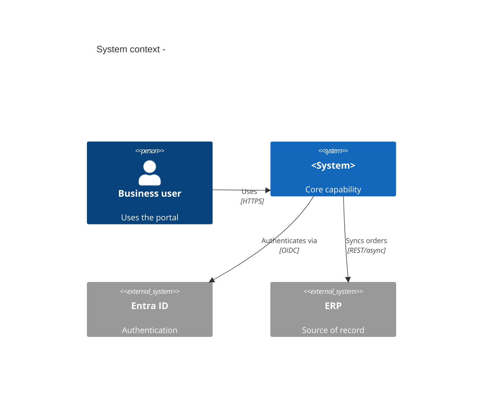
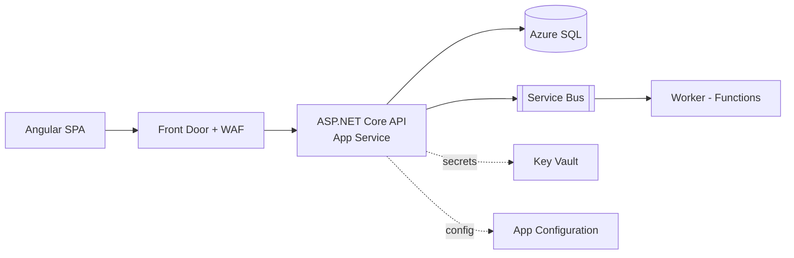

# Deliverable Templates

Use the smallest artifact that serves the audience. Executives: 1-page brief. Engineers: HLD + ADRs. Reviewers: findings list.

## 1. Solution Brief (1-2 pages)

```
# <Solution name>
Status: Draft | Proposed | Approved   Owner:   Date:

## Outcome
<business result, success metrics>

## Recommendation
<one paragraph> Key reasons: 1) 2) 3)

## Scope
In: ...  Out: ...

## Constraints and Assumptions
FACT / ASSUMPTION / OPEN QUESTION lists

## Options considered
<short table: option, summary, cost range, main risk, verdict>

## Architecture (see HLD)
## Cost: build / run (ranges, assumptions)
## Risks (top 5)
## Roadmap (phases, exit criteria)
## Decisions needed (who, by when)
```

## 2. High-Level Design (HLD)

Sections: 1 Context and goals; 2 NFRs with numbers; 3 Context diagram; 4 Container diagram; 5 Key flows (sequence); 6 Data (entities, ownership, retention, classification); 7 Integration contracts (API/event, versioning, idempotency); 8 Identity and security; 9 Deployment topology + environments; 10 Observability and operations; 11 Resilience/DR; 12 Cost; 13 Risks; 14 ADR index; 15 Open questions.

### C4 in Mermaid





Rules: label every arrow with protocol and sync/async; mark trust boundaries; show data stores with owner; keep one diagram per question.

## 3. ADR

Use `architecture-designer/references/adr-template.md`. File name `docs/adr/NNNN-short-title.md`. Must include: Status, Context (forces), Decision, Alternatives (with why rejected), Consequences (positive/negative/neutral), Reversibility (one-way/two-way), Revisit trigger, Owner.

## 4. Architecture Review Findings

| # | Severity (Critical/High/Med/Low) | Area | Finding | Evidence (file/line/doc) | Impact | Recommendation | Effort |
|---|----------------------------------|------|---------|--------------------------|--------|----------------|--------|

Group: Security, Reliability, Data, Performance, Cost, Operability, Maintainability, Delivery. End with: top 3 fix-now, deferred-with-reasoning, strengths worth keeping. Do not report style opinions as findings.

## 5. Migration / Modernization Plan

Per workload choose: Retire | Retain | Rehost | Replatform | Refactor | Rebuild | Replace. Then: dependencies map, cutover strategy (strangler, parallel run, big bang with rollback window), data migration (volume, tooling, validation, reconciliation), rollback per phase, freeze windows, comms, decommission criteria.

## 6. Roadmap

| Phase | Goal | Scope slice | Exit criteria | Depends on | Rollback |
|-------|------|-------------|---------------|-----------|----------|

Phase 0 = thin vertical slice proving the riskiest assumption (auth, integration, performance, data migration). Each phase ships value or retires a named risk.

## 7. Stakeholder Summary (executive)

3-5 bullets: decision requested, recommendation, cost range, key risk, timeline. No jargon.
